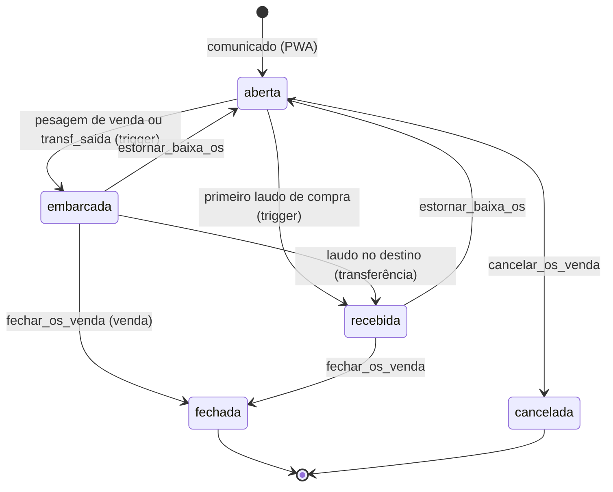

# Módulo Comercial: comunicados, recepção e ordens de serviço

Documento de referência para agentes. Cobre o PWA (`Caderneta-Digital-Gesta-Up`) e o Painel Web (`GestaUp-Cadernetas-Gestao`), que compartilham o banco `nrwljcvhwbezmoummxbl`. Referências no formato `arquivo:linha`. Caminhos do PWA relativos a `frontend/src/`; caminhos do Painel relativos a `apps/manejus/src/`.

> Para quem está começando: leia as seções 1, 3 e 7. As demais servem de consulta.

## 1. Visão geral

- Os três comunicados (venda, compra e transferência) são **linhas em `ordens_servico`** (a OS), diferenciadas por `tipo`. Não existe tabela de comunicado.
- A recepção de animais grava em `os_recebimentos` (um laudo por caminhão/GTA) e, para compra, gera movimentações de entrada.
- O **peão** cria comunicados e recepções pelo PWA, offline-first. O **controller** gerencia pelo Painel: consulta, anexa documentos, confere cargas de transferência, fecha, cancela e estorna.
- A **mudança de status é feita pelo banco** (triggers e RPCs), não pelo app. O PWA só escreve `statusOs: 'aberta'` na criação.
- Não há push notification no PWA. "Notificação" aqui é (a) notificação interna do Painel (`notificacoes`) e (b) compartilhamento de texto por WhatsApp.

## 2. Mapa de telas

### PWA

| Tela | Rota (`App.tsx:693-704`) | Arquivo (`pages/cadernetas/`) | Card (`utils/constants.ts:77-80`) |
|---|---|---|---|
| Comunicado de Venda | `/caderneta/comunicado-venda` (+ `/lista`) | `ComunicadoVendaPage.tsx`, `ComunicadoVendaListaPage.tsx` | `comunicado-venda`, grupo Comercial |
| Comunicado de Compra | `/caderneta/comunicado-compra` (+ `/lista`) | `ComunicadoCompraPage.tsx`, `ComunicadoCompraListaPage.tsx` | `comunicado-compra`, grupo Comercial |
| Comunicado de Transferência | `/caderneta/comunicado-transferencia` (+ `/lista`) | `ComunicadoTransferenciaPage.tsx`, `ComunicadoTransferenciaListaPage.tsx` | `comunicado-transferencia`, grupo Comercial |
| Recepção Animais | `/caderneta/recebimento-compra` (+ `/lista`) | `RecebimentoCompraPage.tsx` (~810 linhas), `RecebimentoCompraListaPage.tsx` | `recebimento-compra`, grupo **Gado & Pastagens** |
| Ordem de Serviço (embarque) | Sem tela própria: o seletor de OS fica dentro de `/caderneta/pesagem` | `PesagemPage.tsx` | — |

- As listas são wrappers de `components/cadernetas/ListaRegistros`, que lê **só** o IndexedDB.
  - Venda, compra e transferência leem a store `ordens-servico` e filtram por `tipo` (venda usa `(r.tipo || 'venda') === 'venda'`).
  - Recepção lê a store `os-recebimentos`, sem filtro.

### Painel Web

Todas as rotas usam `ControllerRoute` + `ControllerLayout` (`App.tsx:1395-1452`).

| Rota | Componente (`pages/controller/`) | Observação |
|---|---|---|
| `/controller/cadernetas/comunicado-venda` | `ComunicadoVenda.tsx` → `OrdensServico tipoFixo="venda"` | Reutiliza a listagem |
| `/controller/cadernetas/comunicado-compra` | `ComunicadoCompra.tsx` → `tipoFixo="compra"` | idem |
| `/controller/cadernetas/comunicado-transferencia` | `ComunicadoTransferencia.tsx` → `tipoFixo="transferencia"` | idem |
| `/controller/cadernetas/recebimento-compra` | `RecebimentoCompra.tsx` | Lista `os_recebimentos` |
| `/controller/ordens-servico` | `OrdensServico.tsx` | Busca e filtros no cliente |
| `/controller/ordens-servico/:id` | `OrdemServicoDetalhes.tsx` | Ações de fechar, cancelar, estornar, conferir e documentos |

No Painel, **não há formulário de criação de comunicado**. O controller só lista e gerencia.

Principais funções:
- `OrdensServico.tsx`: `loadOrdens` (~l.69) filtra `fazenda_id` ou `fazenda_destino_id` e traz nomes das fazendas pelas FKs.
- `RecebimentoCompra.tsx`: `loadRecebimentos` (~l.49) traz `os_recebimentos` com `ordens_servico(numero_os, tipo)`.
- `OrdemServicoDetalhes.tsx`:
  - `loadTudo` (~l.185): OS, movimentações com `os_id`, contagem de pesagens, documentos e recebimentos (compra/transferência).
  - `handleFechar` (~l.302) chama `fechar_os_venda`.
  - `handleCancelar` (~l.335) chama `cancelar_os_venda`.
  - `handleEstornar` (~l.353) chama `estornar_baixa_os`.
  - `handleConferirRecebimento` (~l.285) chama `conferir_recebimento_transferencia`.
  - Regras de botões (~l.374-382):
    - `podeEstornar`: status `embarcada`, `recebida` ou `aguardando_pagamento`.
    - `podeFechar`: na transferência, exige `recebida` e todas as cargas conferidas; nos demais, mesma regra de estorno.
    - `podeCancelar`: status `aberta`.
- Documentos: `services/osDocumentosService.ts`. Tipos aceitos: `romaneio | acerto | gta | nota_fiscal | laudo | video | outro`. Upload comprime, grava no bucket `documentos-os` em `<fazenda>/<os>/...` e insere em `os_documentos`. Exclusão é soft-delete seguido de remoção do arquivo. URLs assinadas com TTL de 3600 s.

## 3. Liberação do módulo

- **`fazendas.acesso_comercial`** (boolean, default `false`, migration `20260927130000`). Lido no login para `config.acessoComercial` (`store/slices/configSlice.ts`, `Home.tsx:207`).
- O grupo Comercial só aparece se a flag estiver ligada: `ModulosMenuPage.tsx:32,52` (`CADERNETAS_COMERCIAL`) e `ProgramacaoHojePage.tsx:97-104`.
- **Transferência** exige também outra fazenda ativa no mesmo grupo (`temFazendaNoGrupo`, `ModulosMenuPage.tsx:37,63`). A tela `ComunicadoTransferenciaPage` mostra "Transferência indisponível" nesse caso (~l.137).
- **Recepção** não está no grupo Comercial; fica em Gado & Pastagens e não depende da flag.
- Não está em `CADERNETAS_EM_TESTE` (`constants.ts:102`).
- O RBAC por funcionário (`funcionarioCadernetas`) vale por cima das flags.
- Segundo o HISTORICO, apenas a fazenda de testes tem a flag ligada no momento.

## 4. Campos e mapeamento

### Comunicado de Venda (`ComunicadoVendaPage.tsx`; regras ~l.66-92; save ~l.96-131)

| Campo local | Coluna Supabase | Obs. |
|---|---|---|
| `data` | `data` | |
| `tipoVenda` (`abate` / `animal_vivo`) | `tipo_venda` | Radio |
| `vendedor` | `vendedor` | Label "VENDEDOR" |
| `comprador` | `comprador` | Label "EMPRESA/FAZENDA" |
| `vendaDireta` (S/N) | `venda_direta` | Se N, `corretora` é obrigatória |
| `corretora` | `corretora` | |
| `quantidadePrevista` | `quantidade_prevista` | Obrigatória, > 0 |
| `sexo` (Macho/Fêmea) | `sexo` | |
| `idadeEra` | `idade_era` | `0-4m`, `5-12m`, `13-24m`, `25-36m`, `>36m` |
| `dataPrevistaEmbarque` | `data_prevista_embarque` | |
| `dataPrevistaAbate` | `data_prevista_abate` | Só aparece e é obrigatória no tipo abate |
| `dataPrevistaPagamento` | `data_prevista_pagamento` | Opcional |
| `precoArroba` | `preco_arroba` | Opcional, `normalizarNumero` |
| `observacao` | `observacao` | |

Payload adiciona `tipo: 'venda'` e `statusOs: 'aberta'`.

### Comunicado de Compra (`ComunicadoCompraPage.tsx`; regras ~l.55-73; save ~l.77-107)

| Campo local | Coluna Supabase | Obs. |
|---|---|---|
| `comprador` | `comprador` | Quem negociou pela fazenda |
| `fornecedor` | `fornecedor` | Label "EMPRESA" (vendedor externo) |
| `quantidadePrevista`, `sexo`, `idadeEra` | idem | |
| `dataSaida` | `data_saida` | Data de embarque na origem |
| `dataPrevistaEmbarque` | `data_prevista_embarque` | **Semântica reaproveitada**: significa "chegada na fazenda" |
| `observacao` | `observacao` | |

Payload adiciona `tipo: 'compra'` e `statusOs: 'aberta'`. As colunas legadas `origem_fazenda`, `origem_municipio_uf`, `modo_preco`, `valor_total_previsto`, `forma_pagamento`, `valor_frete` e `compra_detalhes` existem no schema mas não são preenchidas pelo PWA atual.

### Comunicado de Transferência (`ComunicadoTransferenciaPage.tsx`; save ~l.90-123)

| Campo local | Coluna Supabase | Obs. |
|---|---|---|
| `solicitante` | `vendedor` | **Semântica reaproveitada** |
| `fazendaDestinoId` | `fazenda_destino_id` | Destinos vêm de `getFazendasDoMesmoGrupoCached` (~l.56-61) |
| `fazendaDestinoNome` | — | **Só local**, para exibição |
| `quantidadePrevista`, `sexo`, `idadeEra` | idem | |
| `dataSaida` | `data_saida` | Embarque na origem |
| `dataPrevistaEmbarque` | `data_prevista_embarque` | Chegada prevista no destino |
| `observacao` | `observacao` | |

Payload adiciona `tipo: 'transferencia'` e `statusOs: 'aberta'`. `fazenda_destino_id` só é enviado quando `tipo === 'transferencia'` (há CHECK `ordens_servico_destino_so_transferencia` no banco).

### Recepção (`RecebimentoCompraPage.tsx`; ~810 linhas)

Constantes:
- `CHECKLIST_ITENS` (~l.21-40): **18 itens** no PWA. O comentário da migration `20260925120000` fala em 20, então o número real é 18; a coluna `checklist` é jsonb e aceita qualquer lista.
- `CATEGORIAS_RECEBIMENTO` (~l.42-46): 14 categorias.
- Estado do formulário (~l.60-89).

Seções do formulário:
1. **OS de compra ou transferência**: seletor "OS DE COMPRA / TRANSFERÊNCIA" (~l.427). Lista as OS de compra abertas ou recebidas e as de transferência em `embarcada` ou `recebida`.
2. **Documentos e transporte**: `numeroGta` (obrigatório), `numeroNf`, `docOrigem`, `transportadora`, `placaVeiculo`, `placaReboque`, `motorista`, `dataChegada` (obrigatória), `horaChegada`.
3. **Quantidades recebidas**: linhas `contagens[]` com `{categoria, femeas, machos}`. Total precisa ser > 0.
4. **Balanção**: `pesoEntrada` e `pesoSaida` são **só locais** (sem coluna). `pesoMedioKgCab` é calculado como (entrada − saída) ÷ total de cabeças (~l.231-237) e grava em `peso_medio_balancao`. `horaPesagem` → `hora_pesagem`.
5. **Lote de destino**: `loteId`/`loteNome` (obrigatório), escolhido em `SearchableModal` (`lotesPastoMap`). Vai para `lote_destino_id` e `lote_destino`. Campo `observacao` abaixo.
6. **Checklist**: cada item S/N com observação; `scoreCorporal` 1 a 5 (`score_corporal`); `mortes` (`mortes`).
7. **Vídeo do descarregamento**: `handleVideoChange` (~l.269-281) recusa arquivo acima de ~450 MB e avisa acima de 100 MB.
8. **Responsável**: `responsavel` (obrigatório) e `auxiliar`.

Payload `os-recebimentos` (`syncService.ts` ~l.847-881): `os_id`, `numero_gta`, `numero_nf`, `doc_origem`, `transportadora`, `placa_veiculo`, `placa_reboque`, `motorista`, `data_chegada`, `hora_chegada`, `peso_medio_balancao`, `hora_pesagem`, `contagens`, `checklist`, `score_corporal`, `mortes`, `destino`, `lote_destino_id`, `lote_destino`, `responsavel`, `auxiliar`, `observacao`, `sessao_id`. Campos legados `peso_origem` e `destino` (texto) também são enviados.

## 5. Escrita: caminho offline-first

Não há escrita direta no Supabase em nenhuma tela deste módulo. O fluxo é:

1. **Salvar local.** `salvarRegistro` (`services/api.ts:20`) roda `validate()` (`validateOrdensServico` / `validateOsRecebimento`, `utils/validation.ts:1330-1331`), grava no IndexedDB e enfileira com `enqueueRegistro(caderneta, id, 'create')` (~l.97).
   - Observação: o módulo **não usa** o hook `useSalvarRegistro`; chama `salvarRegistro` direto. O resultado é o mesmo caminho da convenção.
2. **Ordem da fila.** `services/indexedDB.ts` (`getSyncQueue` ~l.209-217): `ordens-servico` (4), `os-recebimentos` (5), `pesagem` (6), `movimentacao` (7). Isso garante que a OS exista no servidor antes de qualquer registro que referencie `os_id`.
3. **Mapeamento de tabela.** `syncService.ts:96-97`: `ordens-servico` → `ordens_servico`, `os-recebimentos` → `os_recebimentos`. Ambas estão na lista de upsert (~l.1332-1333).
4. **Payload.** `registroToSupabase`:
   - `ordens-servico` (~l.807-846): `id` e `local_id` = id local.
   - `os-recebimentos` (~l.847-881).
   - `movimentacao` (~l.437-445): inclui `os_id`, `os_recebimento_id`, `sessao_id`, `tipo_saida`/`tipo_entrada`, `fazenda_destino_id`.
5. **Envio.**
   - `createOrdemServico` (`supabaseService.ts:3798`): upsert com `onConflict local_id`.
   - `createOsRecebimento` (~l.3847): upsert com `onConflict local_id`. Depois, se houver `videoBlob`, chama `uploadVideoOsRecebimento` (~l.3862-3895): envia para o bucket `videos-os` em `{fazendaId}/{osId}/recebimento-{id}-{ts}.ext`, insere linha em `os_documentos` (`tipo='video'`, `os_recebimento_id`, `bucket`) e remove o arquivo se o insert falhar. Em caso de sucesso, zera `videoBlob` e marca `videoEnviado: true`.
   - Retorno (`syncService.ts` ~l.1479-1487): grava `supabaseId`, `numeroOs` (vindo de `numero_os`, gerado pelo servidor) e `syncStatus: 'synced'`.
6. **Movimentações da recepção de compra** (`RecebimentoCompraPage.tsx` ~l.346-382). Só rodam quando a OS **não** é transferência:
   - Uma `movimentacao` por categoria e sexo.
   - `motivoMovimentacao: 'Entrada'`, `subtipo: 'Compras'`.
   - `loteOrigemId` = lote **receptor** (convenção do schema para Entrada).
   - `pesoVivoAtualKg` = peso médio.
   - `osId`, `osRecebimentoId` e `sessaoId = receb-<uuid>`.
   - O HISTORICO cita uma função `buildMovimentacaoRecebimento`; **ela não existe**. A lógica está inline em `handleSalvar`.

Por que o `id` é `crypto.randomUUID()` na criação: a pesagem e a recepção referenciam a OS como FK antes do sync, então o id precisa ser estável e definitivo desde o início.

## 6. Leitura

| Consumidor | Origem |
|---|---|
| Comunicados (venda, compra) | Só escrita |
| Comunicado de transferência | Destinos do grupo: `cadastroCache.getFazendasDoMesmoGrupoCached` (~l.2805, aquecido ~l.3601). Query: `supabaseService.getFazendasDoMesmoGrupo` (~l.138) |
| Listas (venda, compra, transferência, recepção) | Só IndexedDB (`listarRegistros`) |
| Seletor de OS da recepção (~l.145-207) | Mescla três fontes: `getOrdensServicoAbertasCached(fazendaId, 'compra')`, `getOrdensServicoTransferenciaEntradaCached(fazendaId)` e OS locais de compra não fechadas nem canceladas (marcadas `pendenteSync` quando ainda não subiram). Lotes: `getLotesAtivosCached` e `getLoteByNomeCached`. Equipe: `getCachedCadastroData().funcionarios`. Reage a `CADASTRO_CACHE_UPDATED`. |
| Seletor de OS da pesagem (~l.415-480) | `getOrdensServicoAbertasCached` para `'venda'` e `'transferencia'`, mais OS, pesagens e movimentações locais |

Cache (`services/cadastroCache.ts`):
- `getOrdensServicoAbertasCached` (~l.1147), chave `os-abertas`.
- `getOrdensServicoTransferenciaEntradaCached` (~l.1172), chave `os-entrada`.
- Offline ou rede instável: lê memória e depois o cache de consulta do IndexedDB.
- Online: chama o Supabase com timeout de 3 s e cai no cache se falhar.

Queries (`services/supabaseService.ts`):
- `getOrdensServicoAbertas(fazendaId, tipo)` (~l.3810): filtra `fazenda_id`, `tipo` e `deleted_at is null`. Status `['aberta','recebida']` para compra; `['aberta']` nos demais. Traz o nome da fazenda destino pela FK.
- `getOrdensServicoTransferenciaEntrada(fazendaId)` (~l.3832): filtra `fazenda_destino_id = fazendaId`, `tipo = 'transferencia'`, status `['embarcada','recebida']`. Depende da policy `os_select_fazenda_destino`.

## 7. Ciclo de vida

Campo local `statusOs`; coluna remota `status`. Valores: `aberta`, `embarcada`, `recebida`, `fechada`, `cancelada`, `aguardando_pagamento`.

Passo a passo por tipo:

**Venda**
1. Comunicado cria a OS como `aberta`.
2. Na pesagem, o manejo `abate` ou `venda_vivo` exige OS aberta de venda (`validatePesagem`, `utils/validation.ts:1135-1140`). O seletor filtra por `tipo_venda` (~l.646-651).
3. Ao escolher a OS, o tipo de manejo é travado para o tipo da OS (`handleSelecionarOs` ~l.654).
4. As categorias vêm de `lote_categorias` do lote (`getLoteDetalhesComCategoriasCached`).
5. Ao encerrar a sessão (~l.888-945): pesagens com `os_id` e movimentações `Saída`/`Venda` agrupadas por lote e categoria, com `osId` e `sessaoId`. Movimentações salvas em tentativa anterior são atualizadas e enfileiradas de novo (`movimentacoesSalvas`), não recriadas.
6. Trigger de pesagem baixa os indivíduos e a OS passa a `embarcada`.
7. Fechamento (`fechada`) é manual, no Painel, com valor de acerto e data.
8. Guarda local (`osBloqueada`, ~l.425-447) impede um segundo embarque da mesma OS neste aparelho, a não ser que o servidor tenha alterado a OS depois do último registro local (por exemplo, estorno de volta para `aberta`).

**Compra**
1. Comunicado cria a OS como `aberta`.
2. Cada caminhão ou GTA gera uma recepção, ligada por `os_id`.
3. Cada recepção cria movimentações `Entrada/Compras` no lote receptor.
4. Trigger `trg_os_recebimento_status` move a OS para `recebida` no primeiro laudo. A OS continua aceitando cargas.
5. Os animais são identificados depois, em uma pesagem de manejo `processamento`, sem OS, que cria o indivíduo com origem `Compra`.
6. Fechamento exige ao menos uma GTA, valor maior que zero e data.

**Transferência**
1. Comunicado cria a OS como `aberta`, com `fazenda_id` = origem e `fazenda_destino_id` = destino.
2. Na origem, a pesagem `transf_saida` exige OS. Gera movimentação `Saída` com `subtipo 'Saida'`, `tipoSaida 'Transferência'` e `fazendaDestinoId`.
3. A OS vai para `embarcada`. O banco marca os indivíduos como `Transferido`; o PWA não faz isso.
4. No destino, a recepção lista a OS (status `embarcada` ou `recebida`) e salva o laudo, **sem criar movimentação**.
5. O laudo faz a OS ir para `recebida`.
6. No Painel, o controller confere cada laudo com `conferir_recebimento_transferencia`. Essa função cria as movimentações de **entrada** no lote destino (`tipo_entrada = 'Transferência'`, `fazenda_destino_id` = origem).
7. Fechamento exige GTA, todas as cargas conferidas e não pede acerto.

Manejos manuais `transf_saida` e `transf_entrada` sem OS continuam disponíveis em `TIPOS_MANEJO_PESAGEM`.

## 8. Banco de dados

Migrations relevantes, em ordem (pasta `supabase/migrations/` do **Painel**):

| Arquivo | Conteúdo |
|---|---|
| `20260810140000_transferencia_entre_fazendas_registros.sql` | Enums de transferência em movimentação; `registros_movimentacao.fazenda_destino_id` |
| `20260810170304_…_rpc.sql` (e correções anteriores) | RPC antigo `transferir_lote_entre_fazendas` |
| `20260922260000_modulo_venda_os.sql` | Base do módulo: tabelas, contador, triggers, notificações, RLS, RPCs, bucket |
| `20260923000002_fechar_os_exige_acerto.sql` | Fechamento de venda passa a exigir acerto |
| `20260925120000_modulo_compra_os.sql` | Status `recebida`, colunas de compra, `os_recebimentos`, manejo `processamento` |
| `20260926170000_bucket_videos_os.sql` | Bucket `videos-os` (500 MB) e `os_documentos.bucket` |
| `20260926171000_os_recebimentos_lote_destino.sql` | `lote_destino_id` e `lote_destino` |
| `20260927130000_fazendas_acesso_comercial.sql` | Flag `fazendas.acesso_comercial` |
| `20260927140000_modulo_transferencia_os.sql` | `fazenda_destino_id`, validação de grupo, conferência |
| `20260927150000_transferencia_rls_compartilhada.sql` | `user_has_os_access` e policies de origem e destino |
| `20260927160000_transferencia_os_status_recebida.sql` | Trigger de status de transferência (depois substituído) |
| `20260927170000_transferencia_fix_conferencia_entrada.sql` | Convenção da movimentação de entrada da conferência |
| **`20260928100000_auditoria_modulo_comercial_os.sql`** | **Versão vigente** de quase todas as funções e triggers do módulo |
| `20261007263000_fase5_3_rpcs_escrita_authz.sql` | `guard_w_lote` em `transferir_lote_entre_fazendas` |
| `20261008150000_os_preenche_dados_de_saida_do_individuo.sql` | Trigger de pesagem preenche `data_saida`, `motivo_saida`, `destino_saida`; estorno limpa |
| `20261016290000_sanidade_carencia_e_aviso_os.sql` | `lotes_em_carencia`, `animais_em_carencia`; aviso `CARENCIA_ATIVA` (não bloqueia) |

Os triggers `20261008120000`, `20261015180000`, `20261015200000` e `20261015210000` também mexem na pesagem. Rollbacks em `supabase/rollbacks/`.

### Tabelas

- **`ordens_servico`**
  - Identificação: `id`, `local_id` (UNIQUE), `fazenda_id`, `dispositivo_id`, `nome_usuario`, `data`, `numero_os`, `ano`, `sequencial`. Índice único em (`fazenda_id`, `numero_os`).
  - `tipo`: `venda | compra | transferencia`. `tipo_venda`: `abate | animal_vivo`.
  - `status`: `aberta | embarcada | recebida | aguardando_pagamento | fechada | cancelada`.
  - Venda: `vendedor`, `comprador`, `venda_direta`, `corretora`, `quantidade_prevista`, `sexo` (`Macho | Fêmea | Misto`), `idade_era`, `categoria`, `data_prevista_embarque`, `data_prevista_abate`, `preco_arroba`, `data_prevista_pagamento`, `observacao`.
  - Compra: `fornecedor`, `origem_fazenda`, `origem_municipio_uf`, `modo_preco` (`por_kg | por_ua`), `valor_total_previsto`, `forma_pagamento`, `data_saida`, `valor_frete`, `mortes_transporte`, `divergencia_obs`, `compra_detalhes` (jsonb).
  - Transferência: `fazenda_destino_id`.
  - Resultado: `quantidade_embarcada`, `valor_acerto`, `data_credito`, `closed_at`, `closed_by`, `cancelada_at`, `motivo_cancelamento`.
  - Controle: `sync_status`, `version`, `created_at`, `updated_at`, `deleted_at`.
- **`os_contadores`** (PK `fazenda_id, tipo, ano`): `ultimo_sequencial`. RLS ligado sem policy, então só o trigger acessa.
- **`os_recebimentos`**: um laudo por caminhão/GTA. Colunas de documento, transporte, pesagem, contagem, checklist, destino, equipe e conferência (`conferido`, `conferido_at`, `conferido_por`), mais `sessao_id`, `local_id` (UNIQUE) e colunas de sync.
- **`os_documentos`**: `os_id`, `fazenda_id`, `tipo`, `arquivo_url`, `nome_arquivo`, `uploaded_by`, `os_recebimento_id`, `bucket`, `deleted_at`.
- **Ligações em tabelas existentes**:
  - `registros_pesagem`: `os_id`, `individuo_status_anterior`; manejo `processamento`.
  - `registros_movimentacao`: `os_id`, `sessao_id`, `os_recebimento_id`, `fazenda_destino_id`; CHECK `os_id IS NULL OR sessao_id IS NOT NULL`.

### Triggers (versão vigente)

| Trigger | Função / arquivo | Papel |
|---|---|---|
| `trg_gerar_numero_os` (BEFORE INSERT) | `gerar_numero_os` | Número `VEN`, `COM` ou `TRA` + `-<ano>-00000` via `ON CONFLICT` em `os_contadores`. Reenvio com mesmo `local_id` não gera número novo |
| `trg_os_valida_transferencia` | transferencia | Destino obrigatório, diferente da origem, mesmo `grupo_id` |
| `trg_os_protege_campos` | auditoria | INVOKER. Para escrita direta (`authenticated`), bloqueia mudanças em status, quantidades, acerto, fechamento, cancelamento, número, tipo, fazendas e `tipo_venda` depois de sair de `aberta`. Bloqueia exclusão fora de `aberta`/`cancelada` |
| `trg_os_recebimento_guard` | auditoria | No INSERT, zera conferência e valida fazenda do laudo. Depois de conferido ou com movimentação, laudo não pode ser editado nem excluído. Conferência só muda pelo RPC |
| `trg_os_recebimento_status` | auditoria | Soma `mortes_transporte` e muda status: compra `aberta → recebida`; transferência `embarcada → recebida`. Volta ao anterior se o último laudo sair |
| `trg_movimentacao_os_guard` | auditoria | Bloqueia em OS fechada ou cancelada, e em fazenda que não é ponta da OS. Compra aceita várias sessões; venda e saída de transferência aceitam uma sessão; entrada de transferência gravada pelo app é rejeitada |
| `trg_movimentacao_os_status` | transferencia | Recalcula `quantidade_embarcada` (na transferência, só a origem) e move para `embarcada` ou `recebida` |
| `trg_pesagem_os_guard` | auditoria | Só OS de venda ou transferência, da origem, não cancelada. Roda antes do trigger de indivíduo (ordem alfabética) |
| `trg_registros_pesagem_upsert_individuo` | `20261008150000` | Com `os_id`: nunca cria indivíduo (grava `OS_ANIMAL_SEM_CADASTRO` se não achar); status `Abatido`, `Venda Vivo` ou `Transferido`; guarda `individuo_status_anterior`; se já baixado, grava `OS_ANIMAL_JA_BAIXADO`; preenche dados de saída. Sem OS e manejo `processamento`, cria indivíduo com origem `Compra` |
| `trg_notify_os_criada`, `trg_notify_os_embarcada` | ver seção 9 | Notificações |
| `ordens_servico_updated_at`, `os_recebimentos_updated_at` | — | Timestamp |
| `update_quant_atual_movimentacao` | auditoria | Categoria nova nasce com `quant_base = 0` |

### RPCs (versão vigente; GRANT para `authenticated`)

Todas recusam peão logo no início (`caller_is_peao()` → "Ação restrita ao painel de gestão") e travam a OS com `FOR UPDATE`.

- **`fechar_os_venda(p_os_id, p_valor_acerto, p_data_credito, p_usuario_id)`**
  - Exige `quantidade_embarcada > 0`.
  - Compra e transferência exigem ao menos uma GTA.
  - Transferência exige `recebida`, nenhuma carga pendente, ao menos uma conferida; não pede acerto.
  - Venda e compra exigem valor > 0 e data.
  - Grava `closed_by`.
- **`cancelar_os_venda(p_os_id, p_motivo, p_usuario_id)`**: só com OS `aberta`.
- **`estornar_baixa_os(p_os_id, p_usuario_id)`**: para `embarcada`, `recebida` ou `aguardando_pagamento`:
  - soft-delete das movimentações e dos `os_recebimentos`;
  - volta os indivíduos ao status anterior e limpa dados de saída;
  - recalcula `lote_categorias.quant_atual` com `calculate_quant_atual`;
  - devolve a OS a `aberta`.
- **`conferir_recebimento_transferencia(p_os_recebimento_id, p_usuario_id)`**:
  - só a fazenda destino;
  - OS em `embarcada` ou `recebida`, com quantidade > 0;
  - valida lote de destino e categoria de cada linha;
  - agrupa por categoria e sexo e insere `registros_movimentacao` de `Entrada` (`tipo_entrada 'Transferência'`);
  - marca o laudo como `conferido`.
- **`transferir_lote_entre_fazendas`** (RPC antigo, sem OS): ver seção 11.
- **Helpers**: `caller_is_peao()`, `current_usuario_id()`, `os_fazenda_pertence(os, fazenda)`, `storage_os_object_access(name)` (caminho `<fazenda>/<os>/...`), `user_has_os_access(os_id)`.

### RLS e storage

- `ordens_servico`: `os_manage` (ALL, por `get_peao_fazenda_id()` ou `user_has_fazenda_access`) e `os_select_fazenda_destino` (SELECT para a fazenda destino).
- `os_recebimentos`: `os_recebimentos_manage` (ALL) e `os_recebimentos_select_via_os`.
- `registros_movimentacao`: `movimentacao_select_via_os`.
- `os_documentos`: `os_documentos_manage`, `_select_via_os`, `_insert_via_os`, `_update_via_os` (INSERT e UPDATE exigem `os_fazenda_pertence`).
- Buckets privados: `documentos-os` (imagem, PDF, vídeo, até 200 MB) e `videos-os` (mp4, webm, quicktime, 3gpp, até 500 MB). Policies usam `storage_os_object_access(name)`.

## 9. Notificações e avisos

- Destinatários: usuários de `usuario_fazenda` com papel `admin` ou `controller`, ativos, excluindo os `@gestaup.internal`. Gravadas em `notificacoes` com `acao_url = /controller/ordens-servico/<id>`.
- `notify_os_criada`: "Nova OS de <tipo>: <número>" com quantidade prevista.
- `notify_os_embarcada`: dispara quando o status vai de `aberta` para `embarcada` ou `recebida`. Na transferência embarcada, também avisa a fazenda destino: "Carga a caminho".
- `transferir_lote_entre_fazendas` também notifica.
- Avisos em `logs_sync_errors` (não viram notificação): `OS_ANIMAL_SEM_CADASTRO`, `OS_ANIMAL_JA_BAIXADO`, `CARENCIA_ATIVA`.
- No PWA: compartilhamento de texto por WhatsApp (`utils/shareUtils.ts`): `formatarComunicadoVendaComoTexto` (~l.310), `formatarComunicadoCompraComoTexto` (~l.339), `formatarComunicadoTransferenciaComoTexto` (~l.361), `formatarRecebimentoComoTexto` (~l.383). Disparado pelo `SuccessModal` e pela lista.

## 10. Contrato que o PWA precisa respeitar

- Enviar `local_id` estável em todo upsert.
- Enviar `sessao_id` em toda movimentação com `os_id`.
- Nunca gravar entrada de transferência no destino (o trigger rejeita).
- Gravar o laudo de transferência só com a OS em `embarcada` ou `recebida`.
- Não alterar `status` nem campos de controle (o trigger rejeita).
- Caminho de storage `<fazenda_id>/<os_id>/...`.
- O peão não fecha, cancela, estorna nem confere (`caller_is_peao()`).
- Permissões de menu: `acesso_comercial`, `temFazendaNoGrupo` (transferência) e RBAC.
- Contrato de IDs compartilhado: `comunicado-venda`, `comunicado-compra`, `recebimento-compra`, `comunicado-transferencia` (`utils/constants.ts:77-80`), também usados no Painel (`Dashboard.tsx`, `types/images.ts`).

## 11. Legado e armadilhas

- **RPC `transferir_lote_entre_fazendas`** é o caminho antigo, sem OS: transfere na hora, cria lote no destino com sufixo, dá baixa na origem e grava duas movimentações (`Transferencia`, `Saida`/`Entrada`). Nenhum código TS do Painel o chama; o caminho atual é a OS de transferência.
- **`osBloqueada`** na pesagem é uma guarda local e pode ser destravada pelo servidor (ver seção 7).
- **`Misto`** em `sexo` existe só em dados legados; não é mais oferecido no comunicado.
- **Checklist**: o PWA tem 18 itens; o comentário da migration cita 20. A fonte da verdade é o array `CHECKLIST_ITENS`.
- **`buildMovimentacaoRecebimento`** citado no HISTORICO não existe; a lógica está inline em `handleSalvar`.
- **`aguardando_pagamento`** está na constraint de status e nas RPCs de estorno, mas nenhum código coloca a OS nesse estado.
- **Comunicados de compra e venda** não têm atualização in-place; só remontam quando a tela não foi tocada.
- **Campos reaproveitados**: em compra, `dataPrevistaEmbarque` significa chegada; em transferência, `solicitante` vai para `vendedor`. Ao ler dados, lembrar disso.
- Histórico relevante no `docs/HISTORICO.md`: linhas ~772-776 (balanção e destino), ~848-864 (comunicados simplificados e compra), ~840-846 (transferência), ~780-786 (remoção de "Misto"), ~988-998 (venda via OS), ~1591-1602 (renomeação para "Recepção Animais"), ~257 (suspeita de regras `custom` em `ComunicadoVenda`).

## 12. Verificação deste documento

Quando alterar o módulo, conferir os caminhos e linhas citados com Grep antes de confiar neles; as linhas mudam com facilidade.
